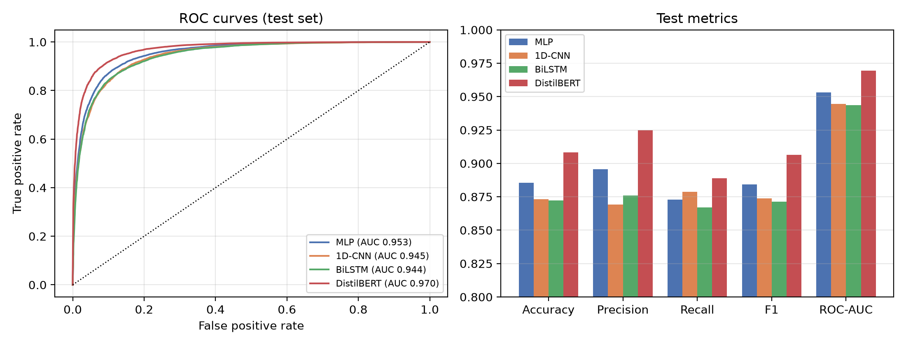

# ICT-4442 Deep Learning Project

## Comparative Analysis of Deep Learning Architectures for Sentiment Analysis of Movie Reviews

Team: Meesha Gupta (230953090), Ratul Jha (230953338), Harshavardhan Reddy (230953396), Kshitij Singh (230953460)
School of Computer Engineering, Manipal Institute of Technology

We compare four architecture families for binary sentiment classification on the
IMDb Large Movie Review Dataset, each owned by one team member:

| Model | Owner | Idea |
|---|---|---|
| MLP over averaged embeddings | Kshitij Singh | order-free bag-of-word-vectors baseline |
| 1D-CNN (kernels 3/4/5) | Ratul Jha | learned n-gram detectors with max-over-time pooling |
| BiLSTM | Harshavardhan Reddy | sequential context in both directions |
| DistilBERT (fine-tuned) | Meesha Gupta | pretrained Transformer, self-attention |

## Common protocol

Every model uses the same data, split, threshold and metrics so the differences come from the architecture:

- Official 25,000-review IMDb training set, split (stratified, seed 42) into **20,000 train / 5,000 validation**.
- Official **25,000-review test set** used once, after training; never for model selection.
- Scratch models: 20,000-word vocabulary fitted on the training split only, sequences of 512 tokens, 128-d learned embeddings.
- DistilBERT: its own WordPiece tokenizer, 256 tokens.
- Early stopping on validation loss with best weights restored; decision threshold 0.5.
- Metrics: accuracy, precision, recall, F1, ROC-AUC, confusion matrix, training and inference time.

## Results (test set, 25,000 reviews)

| Model | Params | Accuracy | Precision | Recall | F1 | ROC-AUC | Median s/epoch |
|---|---:|---:|---:|---:|---:|---:|---:|
| MLP | 2.57 M | 0.8856 | 0.8957 | 0.8729 | 0.8842 | 0.9531 | 2 |
| 1D-CNN | 2.67 M | 0.8732 | 0.8692 | 0.8787 | 0.8739 | 0.9446 | 36 |
| BiLSTM | 2.67 M | 0.8722 | 0.8761 | 0.8670 | 0.8715 | 0.9436 | 78 |
| **DistilBERT** | 66.95 M | **0.9083** | **0.9248** | **0.8888** | **0.9065** | **0.9695** | 108 |

- DistilBERT is significantly better than every scratch model (McNemar, p < 1e-24); the MLP is
  significantly better than the 1D-CNN and the BiLSTM, which are statistically tied (p = 0.66).
- DistilBERT leads on reviews under 300 words but falls behind the MLP on very long reviews,
  because its input is truncated to 256 WordPiece tokens.



All numbers come from `results/<model>/metrics.json`; `results/comparison_table.csv`,
the figures in `results/figures/` and the error analysis in `results/error_analysis.json`
and `results/error_examples.md` are generated from those files by `src/make_figures.py`.

## Repository structure

<!-- BEGIN AUTO-GENERATED REPOSITORY STRUCTURE -->
```text
imdb-sentiment-analysis-ict4442/
├── .github/
│   └── workflows/
│       └── update-readme-structure.yml
├── models/
│   ├── Bilstm.ipynb
│   └── CNN.ipynb
├── scripts/
│   └── update_readme_structure.py
└── README.md
```
<!-- END AUTO-GENERATED REPOSITORY STRUCTURE -->

The structure shown above is regenerated by GitHub Actions on every push to `main`.

- `src/data.py` – dataset download, common split, cleaning and word tokenizer
- `src/models.py` – MLP, 1D-CNN and BiLSTM definitions and their hyperparameters
- `src/train_scratch.py` – trains and evaluates one scratch model
- `src/train_distilbert.py` – fine-tunes and evaluates DistilBERT
- `src/evaluate.py` – shared metrics and result saving
- `src/make_figures.py` – comparison table, figures and error analysis
- `models/*.ipynb` – the Phase 2 (interim) Keras notebooks
- `results/` – metrics, training histories, test probabilities, logs and figures
- `report/` – LaTeX source of the final report

## How to run

Requires Python 3.10+ and, ideally, a CUDA GPU (results were produced on an RTX 3080 Laptop GPU, 8 GB).

```bash
pip install -r requirements.txt
python src/train_scratch.py --model mlp
python src/train_scratch.py --model cnn
python src/train_scratch.py --model bilstm
python src/train_distilbert.py
python src/make_figures.py
```

The IMDb archive (about 80 MB) is downloaded to `data/` on first use. Each script writes
its results to `results/<model>/`.

## Dataset

IMDb Large Movie Review Dataset (Maas et al., 2011): <https://ai.stanford.edu/~amaas/data/sentiment/>
