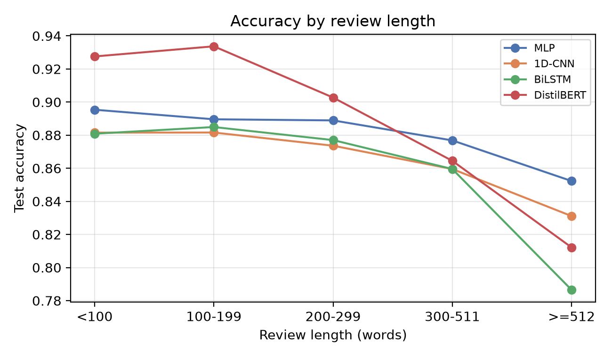
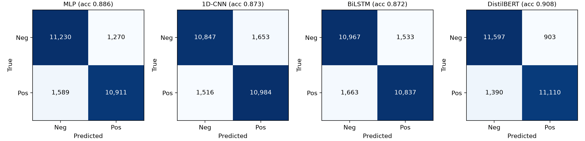
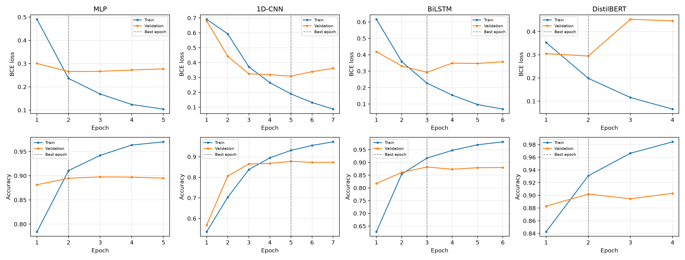
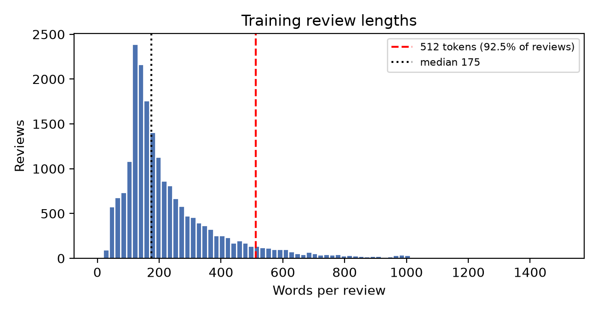

# Sentiment Analysis of Movie Reviews: MLP vs 1D-CNN vs BiLSTM vs DistilBERT

**ICT-4442 Deep Learning · Mini Project · School of Computer Engineering, Manipal Institute of Technology**


We train four very different neural architectures on the **same** IMDb reviews, with the
**same** split, threshold and metrics, so that any difference in the results comes from the
architecture alone. We then ask *why* they differ: which reviews each model gets wrong,
whether the gaps are statistically real, and what each extra point of accuracy costs.

## At a glance

- 🏆 **DistilBERT is the most accurate: 90.83% accuracy, ROC-AUC 0.970.** It beats every
  model trained from scratch by 2.3–3.6 points (McNemar, p < 1e-24).
- ⚡ **The simple MLP is the surprise.** It reaches 88.56%, which is 97% of DistilBERT's accuracy,
  while training about 55× faster per epoch. It also beats the 1D-CNN and the BiLSTM.
- 🤝 **1D-CNN and BiLSTM are statistically tied** (87.32% vs 87.22%, p = 0.66). Both overfit
  20,000 reviews within a few epochs.
- 📏 **Long reviews are the main weakness.** DistilBERT only reads the first 256 tokens, so on
  reviews of 512+ words it falls to 81.2% and the MLP (85.2%) overtakes it.

## Team

| Member | Reg. no. | Model | Phase 2 notebook |
|---|---|---|---|
| Kshitij Singh | 230953460 | MLP over averaged embeddings | [`models/MLP.ipynb`](models/MLP.ipynb) |
| Ratul Jha | 230953338 | 1D-CNN (kernels 3/4/5) | [`models/CNN.ipynb`](models/CNN.ipynb) |
| Harshavardhan Reddy | 230953396 | BiLSTM | [`models/Bilstm.ipynb`](models/Bilstm.ipynb) |
| Meesha Gupta | 230953090 | DistilBERT (fine-tuned) | [`models/DistilBERT.ipynb`](models/DistilBERT.ipynb) |

## Results

Test set: the official 25,000 IMDb test reviews, used once after all training was finished.

| Model | Params | Accuracy | Precision | Recall | F1 | ROC-AUC | Median s / epoch | Test inference (s) |
|---|---:|---:|---:|---:|---:|---:|---:|---:|
| MLP | 2.57 M | 0.8856 | 0.8957 | 0.8729 | 0.8842 | 0.9531 | 2 | 0.25 |
| 1D-CNN | 2.67 M | 0.8732 | 0.8692 | 0.8787 | 0.8739 | 0.9446 | 36 | 12.97 |
| BiLSTM | 2.67 M | 0.8722 | 0.8761 | 0.8670 | 0.8715 | 0.9436 | 78 | 15.55 |
| **DistilBERT** | 66.95 M | **0.9083** | **0.9248** | **0.8888** | **0.9065** | **0.9695** | 108 | 57.14 |

<p align="center">
  
</p>

### Are the differences real?

McNemar's test on the 25,000 per-review predictions:

| Pair | p-value | Verdict |
|---|---:|---|
| DistilBERT vs each scratch model | < 1e-24 | DistilBERT significantly better |
| MLP vs 1D-CNN | 1.8e-8 | MLP significantly better |
| MLP vs BiLSTM | 3.8e-13 | MLP significantly better |
| 1D-CNN vs BiLSTM | 0.66 | No significant difference |

### Where the models fail

<p align="center">
  
</p>

| Review length (words) | < 100 | 100–199 | 200–299 | 300–511 | ≥ 512 |
|---|---:|---:|---:|---:|---:|
| Reviews in test set | 3,106 | 11,747 | 4,708 | 3,645 | 1,794 |
| MLP | 89.5 | 89.0 | 88.9 | 87.7 | **85.2** |
| 1D-CNN | 88.2 | 88.2 | 87.4 | 86.0 | 83.1 |
| BiLSTM | 88.1 | 88.5 | 87.7 | 86.0 | 78.7 |
| DistilBERT | **92.8** | **93.4** | **90.3** | **86.4** | 81.2 |

- **All four models are right on 18,766 reviews and all four are wrong on 586.** These shared
  failures are mostly plot summaries with a one-line verdict, mixed reviews, and reviews that praise
  *other* films.
- **Contrast words cost every model accuracy.** On reviews containing *but*, *however* or
  *although*, all four models score lower.
- **DistilBERT and the MLP fail on different reviews.** DistilBERT fixes 1,779 of the MLP's errors,
  while the MLP fixes 1,213 of DistilBERT's, so an ensemble of the two is a natural next step.

Worked examples of misclassified reviews are in [`results/error_examples.md`](results/error_examples.md).

<details>
<summary><b>More figures: confusion matrices, training curves, review lengths</b></summary>

<br>







</details>

## Common protocol

| | Scratch models (MLP, 1D-CNN, BiLSTM) | DistilBERT |
|---|---|---|
| Data | IMDb train set, stratified split (seed 42): 20,000 train / 5,000 validation | same |
| Tokens | Word tokenizer, 20,000-word vocabulary fitted on train only | WordPiece (pretrained) |
| Sequence length | 512 tokens | 256 tokens |
| Embeddings | 128-d, learned from scratch | pretrained |
| Optimiser | Adam | AdamW, lr 2e-5, fp16 |
| Stopping | Early stopping on validation loss, best weights restored | same |
| Decision threshold | 0.5 | 0.5 |

**Metrics:** accuracy, precision, recall, F1, ROC-AUC, the confusion matrix, and training and inference time.
All runs were on one NVIDIA RTX 3080 Laptop GPU (8 GB).

## Reproduce

```bash
pip install -r requirements.txt

python src/train_scratch.py --model mlp      # under 1 min
python src/train_scratch.py --model cnn      # about 4 min
python src/train_scratch.py --model bilstm   # about 15 min
python src/train_distilbert.py               # about 7 min of GPU time
python src/make_figures.py                   # table, figures, McNemar, error analysis
```

On first use, the IMDb archive (about 80 MB) is downloaded to `data/`. Each run writes its
results to `results/<model>/`: `metrics.json`, `history.json` and the predicted probabilities.
`make_figures.py` builds every table and figure in this README from those files.

## Repository structure

| Path | What it holds |
|---|---|
| `src/data.py` | Dataset download, common split, cleaning, word tokenizer |
| `src/models.py` | MLP, 1D-CNN and BiLSTM definitions and hyperparameters |
| `src/train_scratch.py` | Trains and evaluates one scratch model |
| `src/train_distilbert.py` | Fine-tunes and evaluates DistilBERT |
| `src/evaluate.py` | Shared metrics and result saving |
| `src/make_figures.py` | Comparison table, figures, McNemar tests, error analysis |
| `models/` | Each member's Phase 2 notebook |
| `results/` | Metrics, training histories, predictions, logs and figures for every model |

GitHub Actions regenerates the full file tree below on every push.

<!-- BEGIN AUTO-GENERATED REPOSITORY STRUCTURE -->
<details>
<summary><b>Show / hide the full file tree</b></summary>

```text
imdb-sentiment-analysis-ict4442/
├── .github/
│   └── workflows/
│       └── update-readme-structure.yml
├── models/
│   ├── Bilstm.ipynb
│   ├── CNN.ipynb
│   ├── DistilBERT.ipynb
│   └── MLP.ipynb
├── results/
│   ├── bilstm/
│   │   ├── history.json
│   │   ├── metrics.json
│   │   ├── test_probs.npy
│   │   └── val_probs.npy
│   ├── cnn/
│   │   ├── history.json
│   │   ├── metrics.json
│   │   ├── test_probs.npy
│   │   └── val_probs.npy
│   ├── distilbert/
│   │   ├── history.json
│   │   ├── metrics.json
│   │   ├── test_probs.npy
│   │   └── val_probs.npy
│   ├── figures/
│   │   ├── accuracy_by_length.png
│   │   ├── confusion_matrices_test.png
│   │   ├── curves_bilstm.png
│   │   ├── curves_cnn.png
│   │   ├── curves_distilbert.png
│   │   ├── curves_mlp.png
│   │   ├── review_length_distribution.png
│   │   ├── roc_and_metrics_test.png
│   │   └── training_curves.png
│   ├── logs/
│   │   ├── bilstm.log
│   │   ├── cnn.log
│   │   ├── distilbert.log
│   │   └── mlp.log
│   ├── mlp/
│   │   ├── history.json
│   │   ├── metrics.json
│   │   ├── test_probs.npy
│   │   └── val_probs.npy
│   ├── comparison_table.csv
│   ├── error_analysis.json
│   ├── error_examples.md
│   └── tokenizer.json
├── scripts/
│   └── update_readme_structure.py
├── src/
│   ├── data.py
│   ├── evaluate.py
│   ├── make_figures.py
│   ├── models.py
│   ├── train_distilbert.py
│   └── train_scratch.py
├── .gitignore
├── README.md
└── requirements.txt
```

</details>
<!-- END AUTO-GENERATED REPOSITORY STRUCTURE -->

## Dataset

Maas, A. L. *et al.* "Learning Word Vectors for Sentiment Analysis." *ACL 2011.*
IMDb Large Movie Review Dataset: <https://ai.stanford.edu/~amaas/data/sentiment/>
